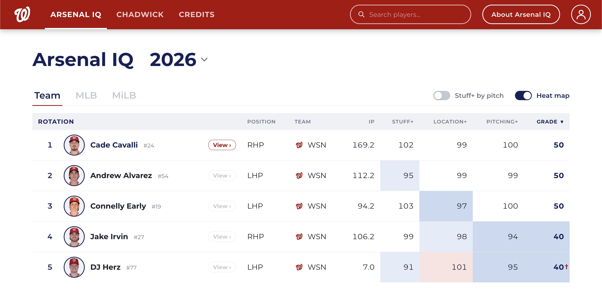

# Arsenal IQ

## Live demo

**Try it here: [www.olafschweinsberg.com/arsenal-iq](https://www.olafschweinsberg.com/arsenal-iq/)**

It runs in any modern browser, on desktop or phone. No sign-up or install is needed.

<p align="center">
  <a href="https://www.olafschweinsberg.com/arsenal-iq/">
    
  </a>
</p>

An experimental hobby project: a Vue 3 + Vite mockup of a pitching-analytics app for a baseball front office. I built it for a Washington Nationals job application.

**This project is not affiliated with, endorsed by or connected to MLB or the Washington Nationals.** Team names and player names belong to their owners and appear for illustration only. The logos in this repo are placeholders.

## Features

- **Arsenal IQ:** a ranked table of Nationals pitchers by Stuff+, Location+ and Pitching+, shown as 20-80 grades with the raw "+" values alongside. It has per-pitch columns, a heat-map view and a stats cheat sheet.
- **Pitcher Profile** (Cade Cavalli only): grade cards, an arsenal table, a movement chart, a Location+ map and a process-vs-results comparison.
- **Chadwick:** a scripted assistant that answers a few questions about the pitcher with charts and tables. It is not connected to a real language model.
- **User guide and player search** in the header.

## How it works

- A single-page app: Vue 3, Vue Router (history mode, base `/arsenal-iq/`) and Vite.
- `data/` holds API-shaped JSON. The app reads it only through `src/services/`, so a real backend could replace it later.
- `scripts/` holds the Python scripts that derive the 20-80 grades and build the synthetic data files.
- Grades use `50 + 10 * z`, rounded to the nearest 5 and clamped to 20-80, with role and pitch-type spreads taken from the FanGraphs primer.
- **Some data is synthetic.** The Location+ map colors, Chadwick's what-if numbers and the "Model ERA" are invented and labeled illustrative in the app.

## Run it

```bash
npm install
npm run dev      # local dev server
npm run build    # production build in dist/
```

Set `VITE_BASE=/` to build for a root-level host.

## Data sources

- [FanGraphs](https://www.fangraphs.com): Stuff+, Location+ and Pitching+ (see the [model primer](https://library.fangraphs.com/pitching/stuff-location-and-pitching-primer/))
- [Baseball Savant](https://baseballsavant.mlb.com) (Statcast): pitch-level and results data
- [MLB.com](https://www.mlb.com): roster and bio details

The data is a snapshot, partly transcribed by hand. Check it against the sources before using it for anything else.

## License

The code is under the [MIT License](LICENSE). The license does not cover third-party data, names or marks.
